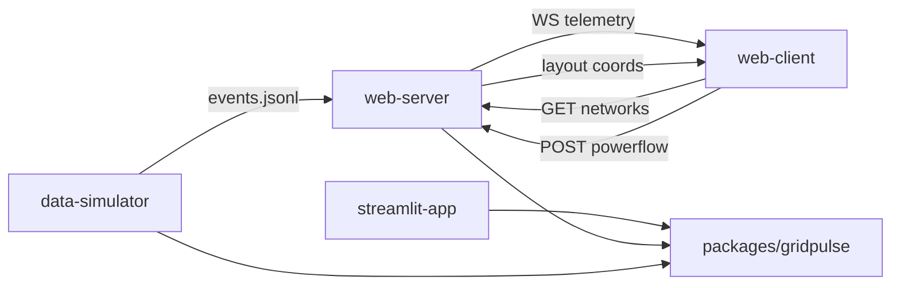

# Grid Pulse — agent runbook

Local checkout: `~/dev/personal/gridpulse`. Remote: `https://github.com/ahmedmsabry2000/grid-pulse.git`. Spec → Issue → Project via `scripts/github/`. Project store docs are source of truth for locked decisions.

## Minirepo layout (own venv each)

| Path | Role |
|------|------|
| `packages/gridpulse/` | Installable core (`-e` target for Python minirepos) |
| `data-simulator/` | Continuous `events.jsonl` writer (separate OS process) |
| `streamlit-app/` | Streamlit + Plotly UI (**kept**; not replaced by deck.gl) |
| `web-server/` | FastAPI REST + WebSocket |
| `web-client/` | React/Vite + deck.gl |

**No shared root venv.** Each folder has its own `.venv` / `node_modules`.



## Setup (per minirepo)

```bash
# Core
cd packages/gridpulse && uv venv && source .venv/bin/activate && uv sync --extra dev --extra ui

# Simulator
cd data-simulator && uv venv && source .venv/bin/activate && uv sync

# Streamlit
cd streamlit-app && uv venv && source .venv/bin/activate && uv sync

# API
cd web-server && uv venv && source .venv/bin/activate && uv sync --extra dev

# Frontend
cd web-client && npm install
```

Python ≥3.11 (CI-local uses 3.12 via uv).

## Tests

```bash
cd packages/gridpulse && uv run pytest --cov=gridpulse --cov-report=term-missing
cd web-server && uv run pytest
cd web-client && npm test && npm run build
```

Coverage floor (core): **75%** (Streamlit `ui/app.py` omitted).

## Live demo — three processes

Shared coupling is only the events file path (`events.jsonl` in cwd, or `GRIDPULSE_EVENTS_PATH`). Prefer running simulator + API from **repo root** so the path matches.

**Terminal A — simulator:**

```bash
cd ~/dev/personal/gridpulse
data-simulator/.venv/bin/gridpulse-simulate --interval 1 --inject-rate 0.1 --seed 42
```

**Terminal B — API:**

```bash
cd ~/dev/personal/gridpulse
GRIDPULSE_EVENTS_PATH="$PWD/events.jsonl" web-server/.venv/bin/uvicorn gridpulse_server.app:app --host 127.0.0.1 --port 8000
```

**Terminal C — deck.gl UI:**

```bash
cd web-client && npm run dev
```

Open http://localhost:5173. Network dropdown + **Run powerflow**. Live ticks arrive over WS.

### Streamlit (still supported)

```bash
cd streamlit-app && source .venv/bin/activate
streamlit run ../packages/gridpulse/src/gridpulse/ui/app.py
```

Open http://localhost:8501. Same events path rules as before. Prev/Next snapshot pages unchanged.

### Batch (non-live) alternative

```bash
packages/gridpulse/.venv/bin/gridpulse --ticks 20 --inject-faults --jsonl events.jsonl
```

Golden UI fixture: `packages/gridpulse/tests/fixtures/golden_events.jsonl`.

## Stages 0–8 (order)

| Stage | Focus | Key check |
|-------|--------|-----------|
| 0 | Scaffold, rules, skills | `test_smoke.py` |
| 1 | `load_network` | `test_network_loader.py` |
| 2 | Telemetry | `test_telemetry.py` |
| 3 | Quality gate | `test_quality_gate.py` |
| 4 | Powerflow | `test_powerflow.py` |
| 5 | Anomalies | `test_anomaly.py` |
| 6 | Pipeline/CLI | `test_pipeline.py` |
| 7 | Streamlit UI | `test_ui_events.py` + live UI |
| 8 | Hardening | coverage + golden fixtures + this file |

Post-8: synthetic layout (`gridpulse.network.layout`), FastAPI/WS, deck.gl client, minirepo split.

## Cursor

- Root rules (short): `.cursor/rules/`
- Per-minirepo rules: `packages/gridpulse/.cursor/rules/`, `data-simulator/.cursor/rules/`, `streamlit-app/.cursor/rules/`, `web-server/.cursor/rules/`, `web-client/.cursor/rules/`
- Skills: `.cursor/skills/gridpulse-*` (incl. `gridpulse-ui`, `gridpulse-github-workflow`)
- Specs: `docs/specs/` → `scripts/github/new-issue-from-spec.sh`
- Containers: `deployment/` (`docker compose` / `podman compose` / `podman-compose`) — see `deployment/README.md`

Domain type: `PNetwork` in `packages/gridpulse` (pandapower + NetworkX). No raw pandapower mutation outside `PNetwork` methods.

## Deferred (do not build without plan revision)

Remote/SCADA, gate severity tiers, PF residual productization, strict mypy, in-app simulator start/stop, real GIS / Mapbox requirement.
