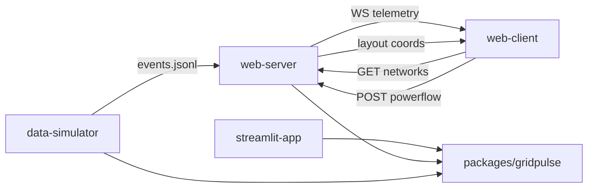

# deck.gl WebSocket UI and minirepo layout

## Goal

Restructure Grid Pulse into top-level minirepos (each with its own venv / `node_modules`), move the installable core to `packages/gridpulse`, add synthetic NetworkX layout + FastAPI REST/WebSocket `web-server`, and a React/Vite + deck.gl `web-client` — while keeping Streamlit as a first-class `streamlit-app` surface.

## Acceptance

- [ ] Core lives at `packages/gridpulse/` with its own `pyproject.toml`; editable install target for other Python minirepos
- [ ] `gridpulse.network.layout` produces deterministic synthetic bus/line coords (NetworkX spring or Kamada–Kawai, fixed seed, cache per network id) as GeoJSON-ready FeatureCollections — no real GIS
- [ ] `data-simulator/` minirepo: own venv; depends on `-e ../packages/gridpulse`; runs the continuous events writer as a separate process
- [ ] `streamlit-app/` minirepo: own venv; depends on `-e ../packages/gridpulse`; Streamlit UI preserved (not deleted); existing Streamlit tests stay green
- [ ] `web-server/` minirepo: FastAPI with `GET /networks`, `GET /networks/{id}/topology`, `POST /powerflow`, `WS /ws/telemetry`; own venv; tails `events.jsonl` → WS fanout; depends on `-e ../packages/gridpulse`
- [ ] `web-client/` minirepo: React/Vite + deck.gl; network dropdown + Run powerflow; consumes REST + WS
- [ ] No shared root venv required for day-to-day runs; `AGENT.md` + per-folder READMEs document setup
- [ ] Tests: layout unit tests, API smoke/unit tests, core + Streamlit still green; light FE smoke if practical
- [ ] Architecture docs/mermaid (if any) show Core as `packages/gridpulse`, not `src_gridpulse`

## Notes

- Out of scope: deleting Streamlit; real GIS / required Mapbox tokens; in-process simulator inside the API
- Simulator remains a separate OS process; shared coupling is only the events file path
- Effort L; may ship as stacked PRs (packages/layout → minirepos → API → FE) but all acceptance must land
- Mermaid reference (correct Core node):

